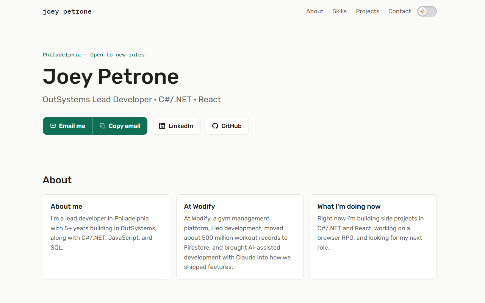
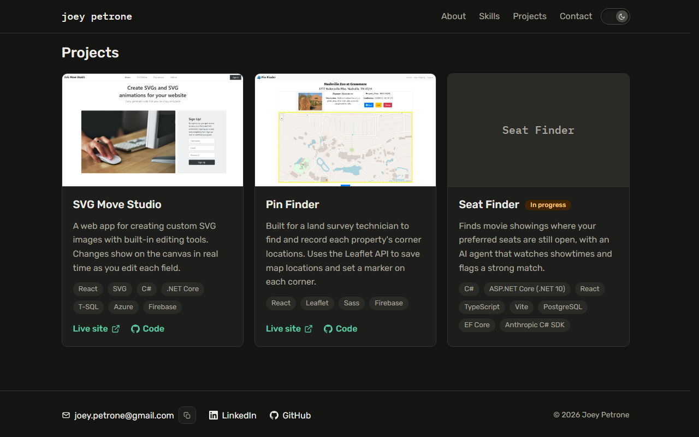
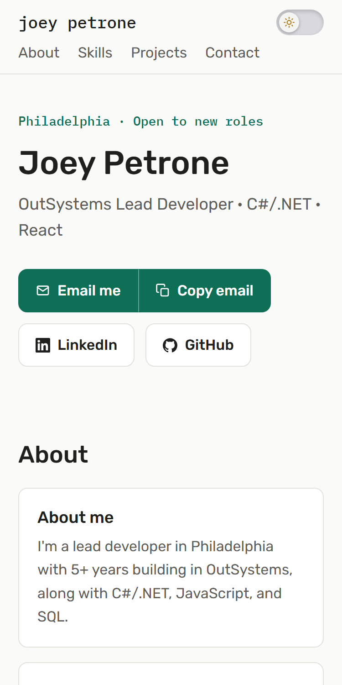

# Personal Bio Site

## Description 
Personal portfolio site for Joey Petrone, OutSystems lead developer and full-stack developer. Live at [joeydev.net](https://joeydev.net).

## Screenshots
### Home (light mode)

### Projects (dark mode)

### Phone

## How to Run
1. Clone this repo, run `nvm use 22`, then `npm install`
2. Run `npm start` (opens http://localhost:5173)

## Editing content
All content is in the repo and goes live with a deploy.

| What | Where |
|---|---|
| Bio | `db/bio.json` |
| Technologies | `db/tech.json` |
| Projects | `db/projects.json` (set `"available": false` to hide one) |
| Project screenshots | `public/images/projects/` (640×400 `.webp`, referenced as `/images/projects/name.webp`) |
| Name, role line, location, contact links, page title, meta description | `index.html` |
| Colors and layout | `src/styles/main.scss` (colors are at the top) |

Entries show in key order (`entry01`, `entry02`, ...). The copyright year updates itself.

## Publishing
1. Check the change locally with `npm start`
2. Commit and push to `main`
3. Build: `npm run build` (output goes to `dist/`)
4. Optional: `npm run preview` to check the built site
5. Deploy: `firebase deploy`

Everything runs on Node 22 (see `.nvmrc`).
