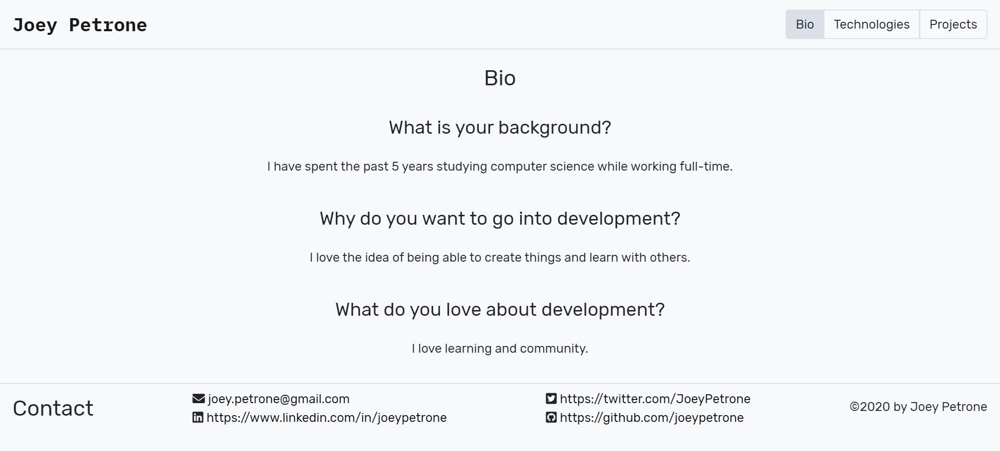
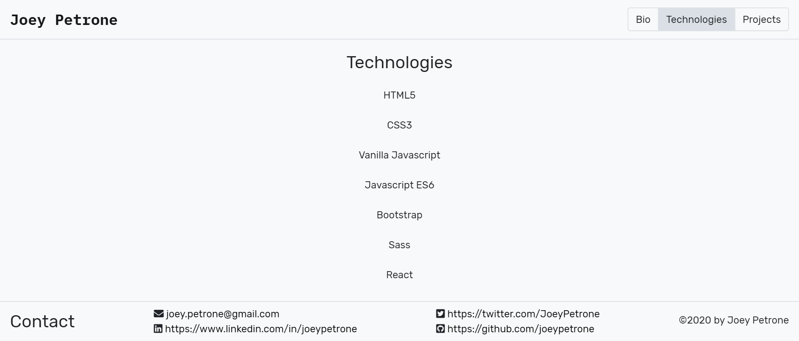
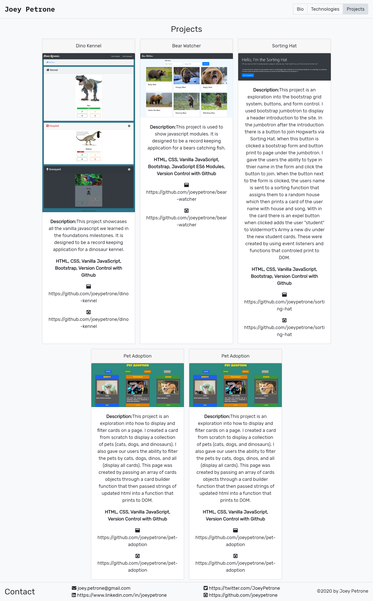

# Personal Bio Site

## Description 
Personal portfolio site for Joey Petrone, OutSystems lead developer and full-stack developer. Live at [joeydev.net](https://joeydev.net).

## Screenshots
### Bio Page (Home)


### Technologies Page


### Projects Page


## How to Run
1. Clone this repo and run `npm install` (Node 18)
2. Run `npm start`, then open http://localhost:8080

## Editing content
All content is in the repo and goes live with a deploy.

| What | Where |
|---|---|
| Bio | `db/bio.json` |
| Technologies | `db/tech.json` |
| Projects | `db/projects.json` (set `"available": false` to hide one) |
| Tagline, contact links, page title, meta description | `src/index.html` |

Entries show in key order (`entry01`, `entry02`, ...). The copyright year updates itself.

## Publishing
1. Check the change locally with `npm start`
2. Commit and push to `master`
3. Build: `npm run build`
4. Deploy:
   ```
   nvm use 22
   firebase deploy
   nvm use 18
   ```

The site builds on Node 18, but the Firebase CLI needs Node 22, so deploying switches versions briefly. This goes away when the project moves to Node 22.
